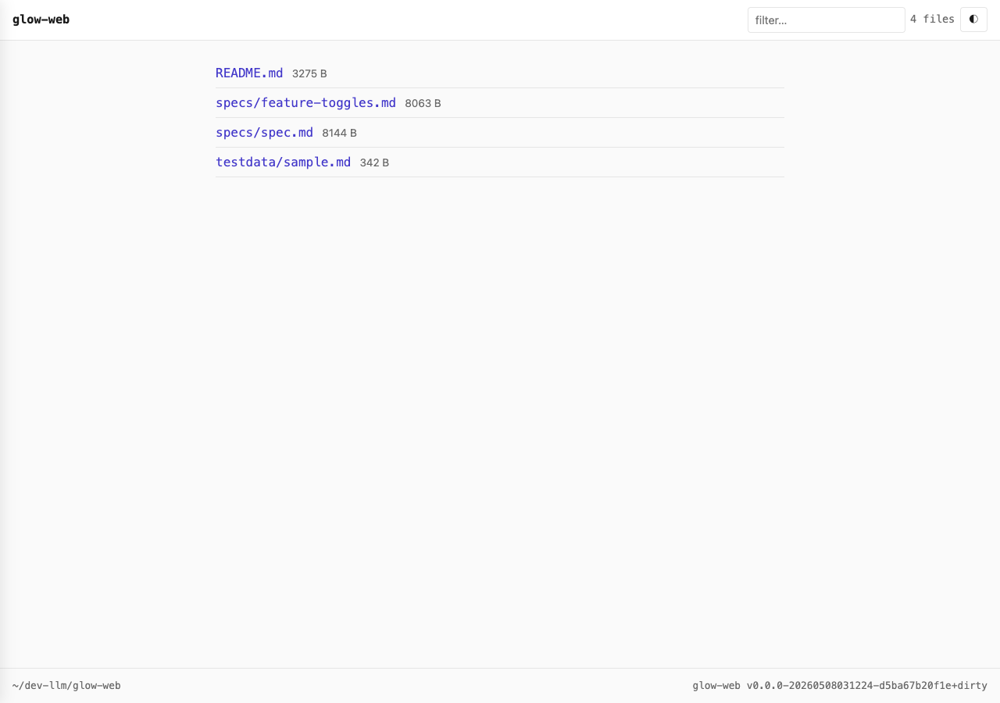
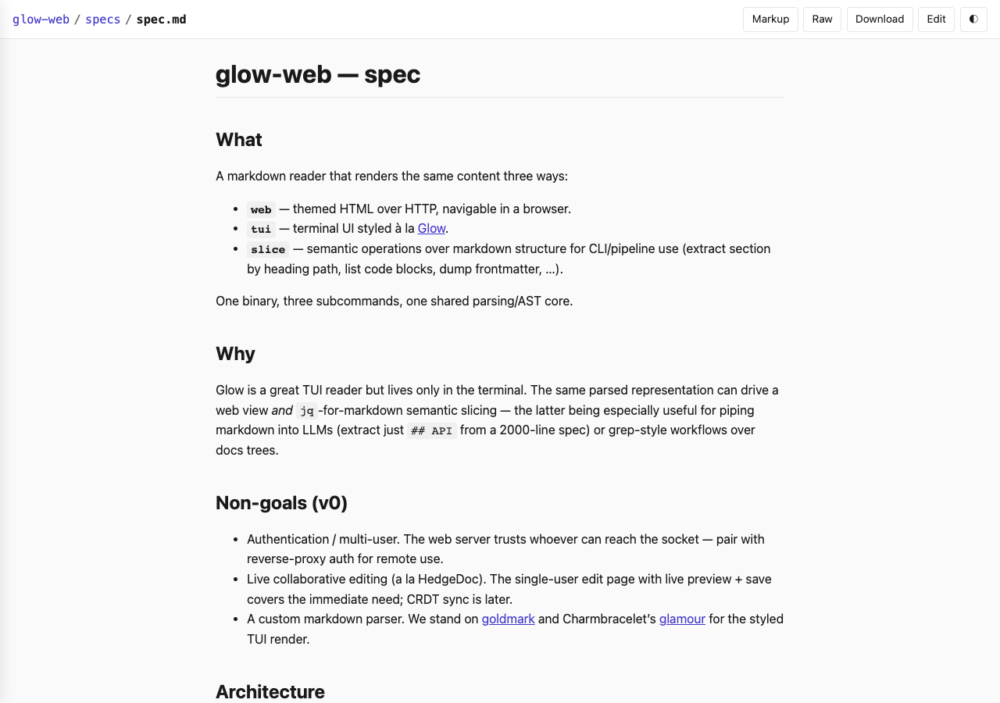
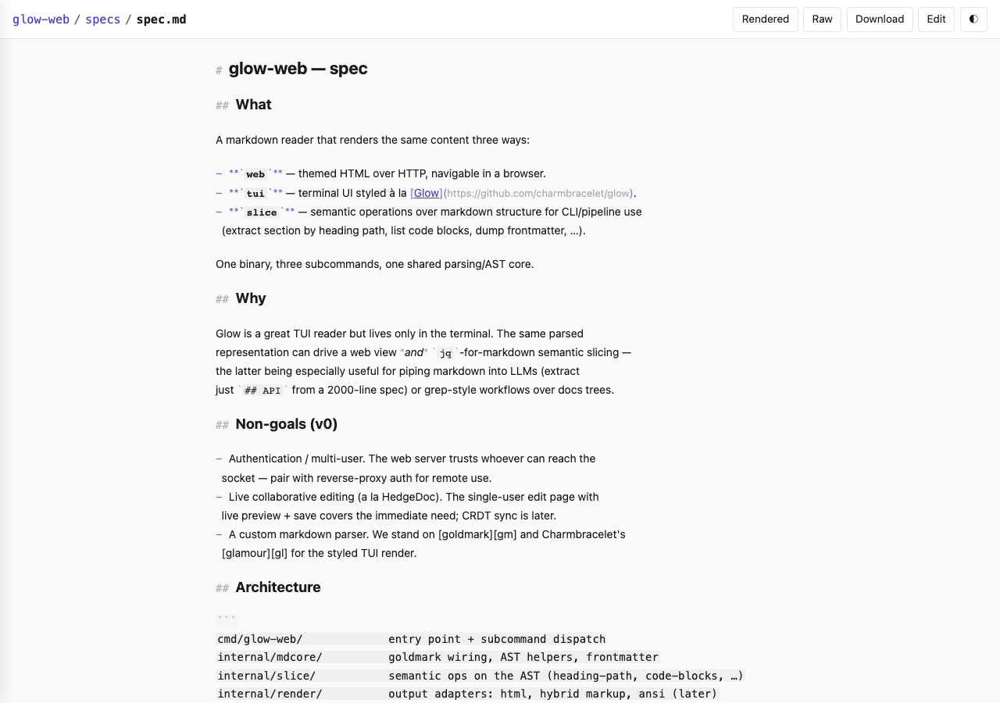
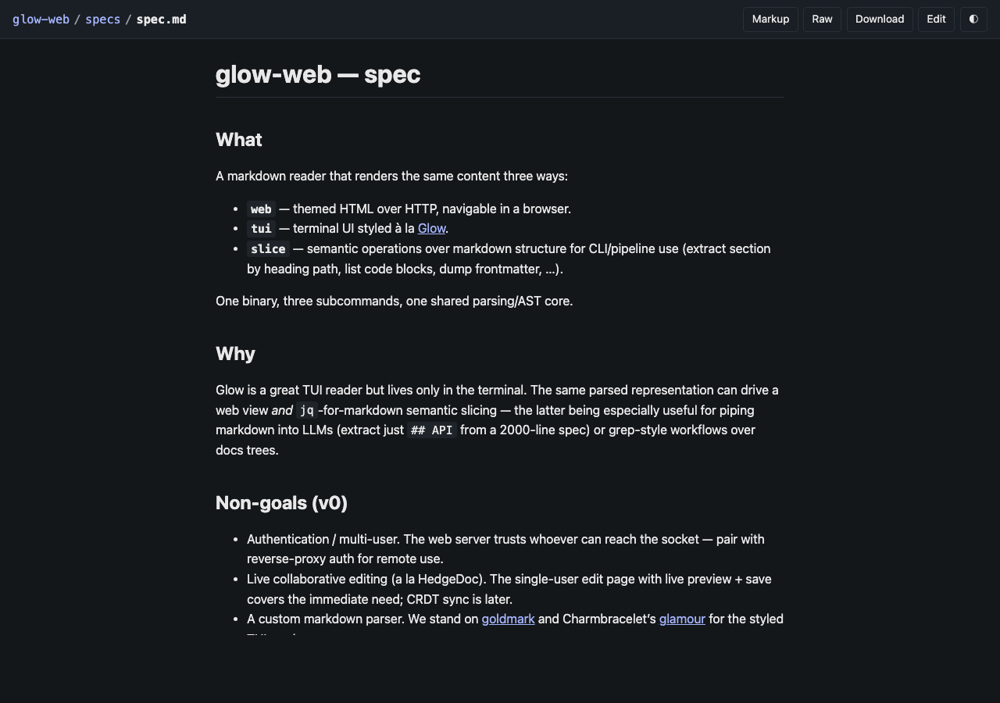
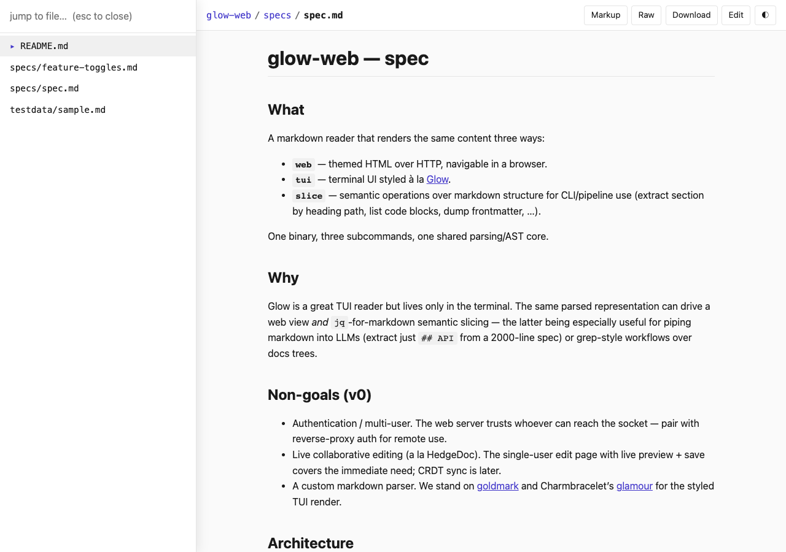

# glow-web

Markdown reader: web, TUI, and CLI semantic slicing — one binary, one AST.

Inspired by [Glow](https://github.com/charmbracelet/glow), Charmbracelet's
TUI markdown reader. glow-web extends the same idea to a browser, with
gitignore-aware directory serving, click-navigable breadcrumbs, intra-project
link rewriting, a hybrid Obsidian-like markup view, an edit page with live
preview, and a `jq`-for-markdown CLI.

See [`specs/spec.md`](specs/spec.md) for vision, scope, and architecture.

## Screenshots

| Index (project file list with fuzzy filter) | Rendered view (light) |
| :---: | :---: |
|  |  |

| Hybrid markup view | Dark theme |
| :---: | :---: |
|  |  |

Persistent file sidebar (⌘K / Ctrl-K, sticks across page navigations):



The bar's `◐` button cycles auto → light → dark; the choice persists in
`localStorage` and overrides the system preference. The sidebar opens on
⌘K / Ctrl-K and stays pinned (close with Esc or another ⌘K) so you can
jump between files without re-summoning it. The viewer also remembers the
scroll position per file in `localStorage`, so coming back to a doc lands
where you left off (skipped when the URL has a `#anchor`).

## Install

```sh
# Install the latest commit on main into $GOBIN (or $GOPATH/bin)
go install github.com/mcint/glow-web/cmd/glow-web@latest

# Or build from a checkout
git clone https://github.com/mcint/glow-web && cd glow-web
make build      # → ./bin/glow-web   (or `go build -o glow-web ./cmd/glow-web`)
```

## Dev tasks

A `Makefile` exposes the common loop. `make` with no target runs the
commit gate (`fmt-check + vet + test`):

```sh
make help          # show all targets
make build         # → ./bin/glow-web
make test          # go test ./...
make check         # fmt-check + vet + test (the commit gate)
make run           # build + serve project root on 127.0.0.1:8080
make screenshots   # re-capture README screenshots (needs playwright + chromium)
```

## Quick start

```sh
# Serve a directory at http://127.0.0.1:8080 (loopback only by default)
glow-web web .

# Serve a single file
glow-web web README.md

# Expose on the LAN
glow-web web . --addr :8080            # ":8080" = all interfaces
glow-web web . --addr 0.0.0.0:8080     # explicit form

# Reverse-proxy mount
glow-web web . --addr :8080 --url-prefix /docs

# Many projects on one port, each at /<name>/ (see "Hub" below)
glow-web web . --hub=auto                # http://127.0.0.1:7171/<this-dir>/

# Unix socket (for Caddy/lmux `reverse_proxy unix//…`, or curl --unix-socket)
glow-web web . --listen unix:/tmp/glow.sock --url-prefix /docs

# Render to HTML on stdout
glow-web render README.md --format html

# Hybrid markup view to stdout (markers visible, content styled)
glow-web render specs/spec.md --format markup

# Extract a section by heading path
glow-web slice specs/spec.md --heading "Architecture"

# Print version
glow-web version
```

## Hub: many projects, one port

One listener per host, every project at `/<name>/`, plus an index at `/`.
The name is the directory's basename in kebab-case (`ClaudeCollab` →
`claude-collab`, the same rule lmux uses); `glow-web name [PATH]` prints it,
and `--name` overrides it. Every page under a hub starts its location with a
**hub** crumb that links back to the index.

There are three ways to put a directory on the hub. They differ only in how
long it stays there:

| how | command | served by | lives until |
|---|---|---|---|
| **pin** | `glow-web publish PATH [--name N]` | the hub, in-process | `glow-web unpublish N` |
| **lease** | `glow-web web PATH --hub=lease` | the hub, in-process | this process exits (even `kill -9`) |
| **proxy** | `glow-web web PATH --hub=proxy` | this process, on its own socket; the hub forwards to it | this process exits |

`--hub=auto` picks for you: lease when the hub runs this exact build, else
proxy. Proxy is the right choice for a `glow-web-dev` session beside a
stable hub, or any time versions differ. The hub's index shows each mount's
version and marks any that differ from the hub's.

**No daemon is needed.** Any `--hub=…` session becomes the hub when none
is running. If that session exits, another takes over within ~2s, on the same
port and URLs. That works because everything the hub knows lives on disk.
For an always-on site, run `glow-web hub` itself (e.g. under launchd): it
joins the same election, so it never collides with a session.

```sh
glow-web publish ~/notes                 # pin: prints "notes"
glow-web hub                             # http://127.0.0.1:7171/ (index) and /notes/
cd ~/dev-llm/glow-web && glow-web web . --hub=auto
glow-web ls                              # pins, leases, proxies, and the hub's pid
glow-web unpublish notes                 # removes the link, never the dir
glow-web web ~/a ~/b                     # ad hoc, no registry: /a/ and /b/ on one port
curl --unix-socket ~/.local/state/glow-web/run/hub.sock http://localhost/_/hub   # JSON status
```

State lives in one dir, `~/.local/state/glow-web/` (`$GLOW_WEB_STATE_DIR` or
`$XDG_STATE_HOME` override it), at 0700. glow-web refuses to use it if it is
group- or world-writable.

```
mounts/<name> -> /abs/dir     pins (plain symlinks: `ln -s` works too)
run/<name>.json               one per open session (flock = alive)
run/<name>.sock               proxy sessions' sockets
run/hub.sock, run/hub.lock    the hub's socket and its election lock
```

**Password protection (HTTP Basic, bcrypt).** Create
`~/.local/state/glow-web/htpasswd` and every hub enforces it on its TCP
port, whichever process holds the hub role. Remove the file to turn auth
off; edits apply without a restart.

```sh
glow-web passwd ann >> ~/.local/state/glow-web/htpasswd   # prompts, no echo
chmod 600 ~/.local/state/glow-web/htpasswd                 # loose modes are refused
glow-web web . --auth-htpasswd FILE                        # standalone (non-hub) server
```

Only bcrypt lines are accepted (`glow-web passwd` or `htpasswd -nB`).
Unix sockets stay ungated: their 0600 mode already limits them to you.
Basic auth is cleartext on a LAN bind (glow-web warns about it), so put
TLS in front.

**Behind lmux.** Add `{"docs": {"sock": "~/.local/state/glow-web/run/hub.sock"}}`
(as an absolute path) to `~/.local/state/lmux/promoted-services.json`, and
every project is at `https://docs.lmux.test:8443/<name>/`, on the same paths
as `127.0.0.1:7171`.

Hub-related flags: `glow-web hub --addr 127.0.0.1:7171 --url-prefix /docs
--allow-host docs.example`. Sessions take `--hub-addr` (or
`GLOW_WEB_HUB_ADDR`), and `--hub-elect=false` stops a session from becoming
the hub. The TCP listener only answers to loopback Host names
(`localhost`, `*.localhost`, `127.0.0.1`, `[::1]`) plus `--allow-host`. The
unix socket is gated by its 0600 mode, which is how a front such as lmux
reaches the hub. Design and rationale: [`specs/unified-listener.md`](specs/unified-listener.md).

## Web flags

```
--addr 127.0.0.1:8080      loopback only by default; ":8080" or "0.0.0.0:8080" for LAN
--listen unix:PATH         listen on a unix socket (0600) instead; also tcp:HOST:PORT
--url-prefix /docs         mount under URL prefix for reverse-proxy use
--gitignore=true           honor .gitignore (dir mode)
--ignore-files .rgignore   comma-separated additional ignore-files
--readonly                 disable the edit page and save endpoint
--markup                   default to hybrid markup view
--palette=true             ⌘K / Ctrl-K command palette (default on)
--theme auto               auto | light | dark (browser toggle overrides)
--title-prefix glow-web    prepended to <title> as "<prefix>: <doc>"; "" disables.
                           Add port to distinguish instances: --title-prefix "glow-web:8080"
--hub off                  off | lease | proxy | auto: join the host's hub (see "Hub")
--name NAME                mount name under the hub (default: derived from PATH)
--auth-htpasswd FILE       HTTP Basic (bcrypt htpasswd) on a TCP listener
```

## Status

v0 spike. See [`specs/spec.md`](specs/spec.md) for the planned surface and
[`specs/feature-toggles.md`](specs/feature-toggles.md) for the design memo
on how config will scale beyond per-flag bools.
